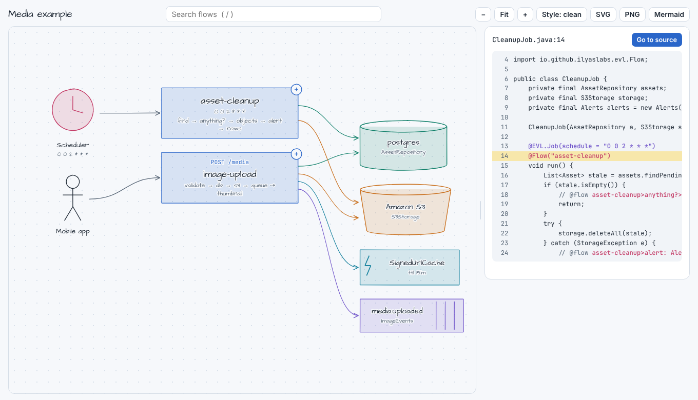
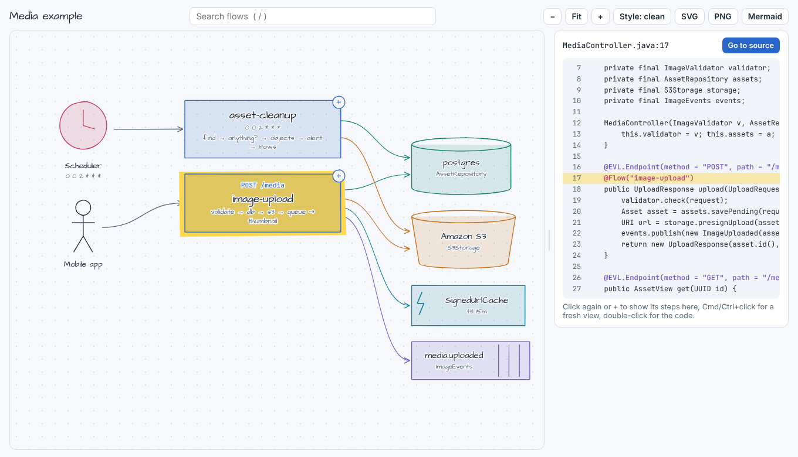
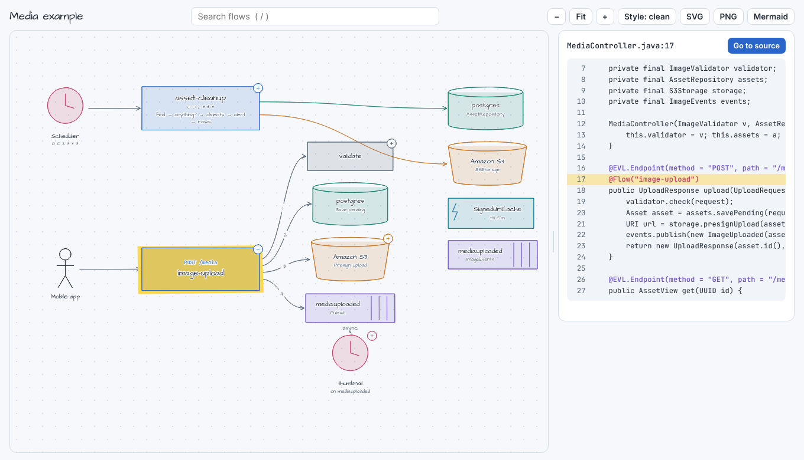

# 2. Your first flow

A **flow** is one thing your system does from start to finish: an upload, a checkout, a nightly clean-up. In this chapter you tag the start of a flow and two of its steps, then open the map.

## Step 1: tag where the flow starts

Pick the method that starts the flow (a controller method, a message listener, a scheduled job) and give it a short, kebab-case id:

```java
public class MediaController {

    @EVL.Endpoint(method = "POST", path = "/media", caller = "Mobile app")
    @Flow("image-upload")
    public UploadResponse upload(UploadRequest request) {
        validator.check(request);
        Asset asset = assets.savePending(request);
        URI url = storage.presignUpload(asset);
        return new UploadResponse(asset.id(), url);
    }
}
```

- `@Flow("image-upload")` creates the flow. `image-upload` is its **path**.
- `@EVL.Endpoint` only decides how it looks: a box showing `POST /media`, and `caller` adds a stick figure on the left. It does not read Spring, JAX-RS or any other framework annotation; you say what it is.

## Step 2: tag the steps

A step is a path that continues its parent's path with `>`:

```java
public class ImageValidator {
    @Flow("image-upload>validate")
    public void check(UploadRequest request) { ... }
}

@EVL.Storage("Amazon S3")
public class S3Storage {
    @Flow("image-upload>s3")
    public URI presignUpload(Asset asset) { ... }
}
```

You never write numbers. EVL follows the calls in `upload()` and sees that `check()` is called before `presignUpload()`, so `validate` is step 1 and `s3` is step 2.

## Step 3: open the map

Press `⌥⌘E` (or **Tools > EVL > Open EVL Map**). The first view shows every flow in the project, who starts it, and the resources it touches:



Click the `image-upload` box. The panel on the right shows its code, ten lines either side of the tag, with **Go to source** to jump there:



Click the **+** on the box to draw its steps right there in the same view:



That's the whole loop: tag, look, adjust. The map updates while you type.

## What you just learned

- A flow starts at a method tagged `@Flow("id")`.
- Steps are paths under it: `id>step`.
- `@EVL.*` picks the shape; it never changes the structure.
- Order comes from your code's calls.

Next: [Paths in depth](03-paths.md)
