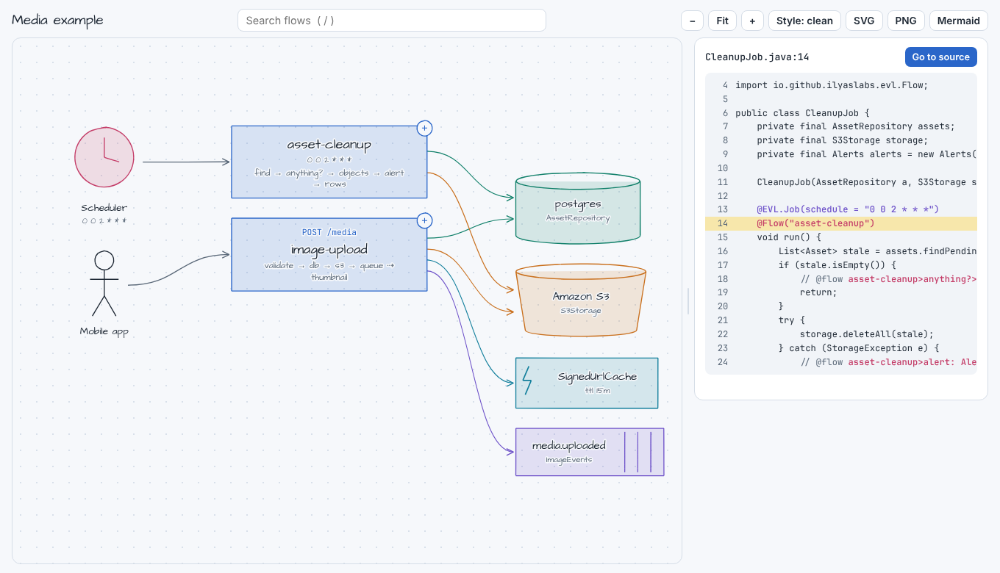

# 4. Symbols and resources

`@Flow` builds the structure. `@EVL.*` annotations only decide how a box is drawn. EVL never looks at Spring, Micronaut, Ktor, JPA or any other framework annotation; tag what matters with EVL's own.

## The symbols

| Annotation | Put it on | Drawn as |
| --- | --- | --- |
| `@EVL.Endpoint(method, path, caller, description)` | the method that serves a request (prefix `path` may sit on the class) | box with `METHOD /path`; `caller` adds a stick figure |
| `@EVL.Job(schedule, trigger, description)` | a scheduled or triggered job method | clock; the schedule or trigger shows under it |
| `@EVL.Database(value, table, description)` | a repository or DAO class or interface | cylinder |
| `@EVL.Storage(value, description)` | a file or object storage client | bucket |
| `@EVL.Queue(value, description)` | a publisher or consumer of a topic or queue | pipe |
| `@EVL.Cache(value, ttl, description)` | a cache | lightning bolt |
| `@EVL.External(value, description)` | a client for a third-party service | cloud |
| `@EVL.Interface(value, description)` | a port or API boundary | box with a lollipop |
| `@EVL.Service(value, description)` | a component worth showing as a box | box |
| `@EVL.Actor(value, description)` | a person or system that calls in | stick figure |

`value` is the name shown on the map. If you leave it out, the class name is used.

## Resources

Database, Storage, Queue, Cache, External, Interface and Service are **resources**. You mark a resource once, on its class:

```java
@EVL.Database("postgres")
public class AssetRepository { ... }

@EVL.Storage("Amazon S3")
public class S3Storage { ... }

@EVL.Queue("media.uploaded")
public class ImageEvents { ... }
```

Then EVL does the rest:

- **Arrows for free.** A step whose code calls into a resource class gets an arrow to that resource. You don't tag every repository call.
- **One resource, many classes.** Classes with the same kind and name are one resource. Two repositories both marked `@EVL.Database("postgres")` point at the same cylinder.
- **Interfaces count.** Mark the interface (`@EVL.Database("postgres") interface AssetStore`) and every class that implements it belongs to the resource.
- **Colours.** Arrows take the colour of the resource they point at, so you can follow "everything that touches S3" at a glance.

## Steps that are a resource

When a `@Flow` method lives in a resource class, the step is drawn as that resource, with what it does as the caption:

```java
@EVL.Database("postgres")
public class AssetRepository {
    @Flow(value = "image-upload>db", label = "Save pending asset")
    public Asset savePending(UploadRequest r) { ... }
}
```

On the `image-upload` level, step 2 is the postgres cylinder captioned "Save pending asset".

## Callers and jobs

The left edge of the map shows **who starts** each flow:

- `caller = "Mobile app"` on an endpoint draws a stick figure with that name. Endpoints with the same caller share one figure.
- `@EVL.Job(schedule = "0 0 2 * * *")` draws a clock with its schedule.
- `@EVL.Job(trigger = "media.uploaded")` describes a job started by an event (see chapter 5).



Next: [Async steps and jobs](05-async.md)
