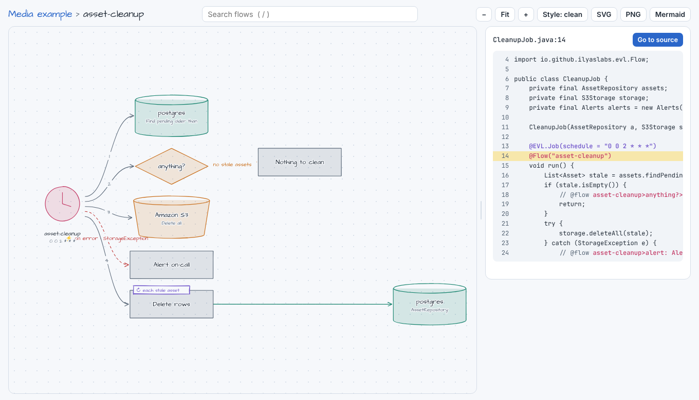

# 6. Branches, loops and errors

Real flows branch, repeat and fail. EVL never guesses these from `if`, `for` or `catch`: a branch is only drawn when you say it matters. That keeps the map about business decisions, not every null check.



## Decisions: `?` segments

A path segment that ends in `?` is a **decision**, drawn as a diamond. Its children are the **arms**, and each arm says when it runs with `when`:

```java
@Flow("checkout")
public Receipt pay(Order order) {
    if (order.paidByCard()) {
        // @flow checkout>payment?>card: Charge the card [when card]
        cards.charge(order);
    } else if (order.paidByWallet()) {
        // @flow checkout>payment?>wallet: Debit the wallet [when wallet]
        wallets.debit(order);
    } else {
        // @flow checkout>payment?>cod: Cash on delivery [when else]
        orders.markCashOnDelivery(order);
    }
    ...
}
```

Drawn: `checkout` → ◇ `payment?` → three arms labelled `card`, `wallet` and `else`.

- You don't tag the diamond itself; `checkout>payment?` is created from its arms. To give it a question as its title, tag it once: `// @flow checkout>payment?: How does the customer pay?`.
- A decision always shows its arms.
- The decision takes its place in the parent's order where its first arm happens.
- Two different `if`s are two different decisions: `payment?` and `stock?`. They never merge by accident.

### An arm with several steps

Go one level deeper:

```java
// @flow checkout>payment?>card: Card [when card]
// @flow checkout>payment?>card>charge: Charge the card
// @flow checkout>payment?>card>receipt: Email the receipt
```

### Nested decisions

A decision inside an arm is just another `?` segment:

```
checkout>payment?>card>3ds?>challenge   [when 3-D Secure required]
checkout>payment?>card>3ds?>skip        [when else]
```

### On annotations

When the arm is a method, use the attribute:

```java
@Flow(value = "checkout>payment?>card", label = "Charge the card", when = "card")
public void charge(Order order) { ... }
```

In Kotlin `when` is a keyword, so write it with backticks: ``@Flow(value = "checkout>payment?>card", `when` = "card")``.

## A single condition

If a step simply runs only sometimes, and there is no real "other arm", skip the diamond and label the arrow:

```java
// @flow image-upload>notify: Warn the user [when quota is almost used]
```

The arrow from the parent reads "if quota is almost used".

## Loops: `each`

```java
// @flow image-upload>resize: Resize [each size in sizes]
for (Size size : sizes) resizer.resize(file, size);
```

or `@Flow(value = "image-upload>resize", each = "size in sizes")`. The box gets a "↻ each size in sizes" badge.

## Error paths: `onError`

```java
try {
    storage.deleteAll(stale);
} catch (StorageException e) {
    // @flow asset-cleanup>alert: Alert on-call [on error StorageException]
    alerts.page(e);
}
```

or `@Flow(value = "asset-cleanup>alert", onError = "StorageException")`. The step is drawn with a red dashed arrow labelled "⚡ on error · StorageException", and it doesn't take a step number, so it never looks like it always happens.

## Refusals and guards

A guard that rejects a request ("only the uploader may complete") is a meaningful branch. Write it as an error path or a decision arm, not a plain step, or readers will think it always runs:

```java
// @flow media-upload>complete>check: Refuse, only the uploader may complete [when caller is not the uploader]
```

## Bracket syntax summary

On inline markers, write any of these after the label, in any order:

| Bracket | Same as | Drawn as |
| --- | --- | --- |
| `[when …]` | `when = "…"` | arm label, or "if …" on the arrow |
| `[each …]` | `each = "…"` | ↻ loop badge |
| `[on error …]` | `onError = "…"` | red dashed error arrow |

Next: [Shared code and big systems](07-shared-code.md)
