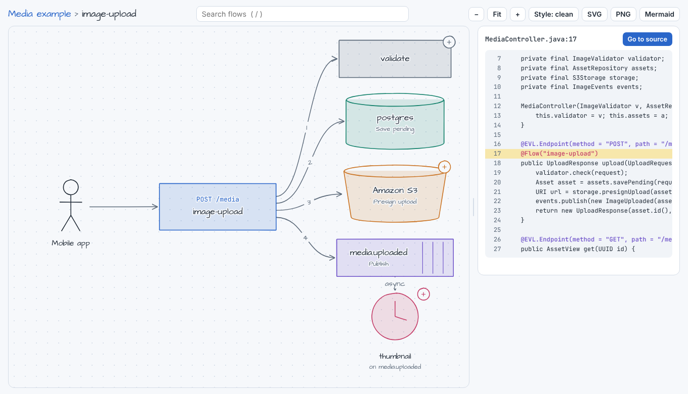
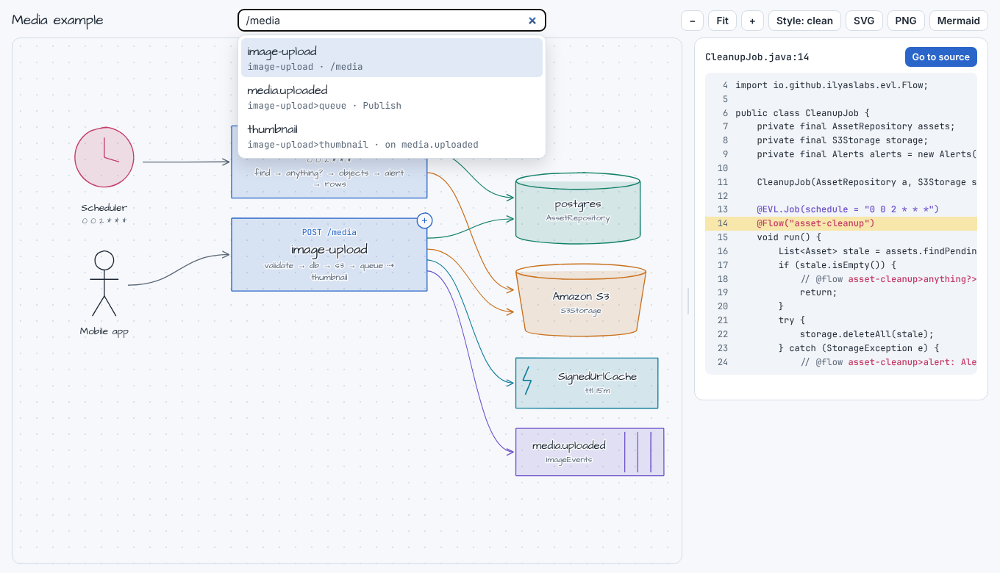
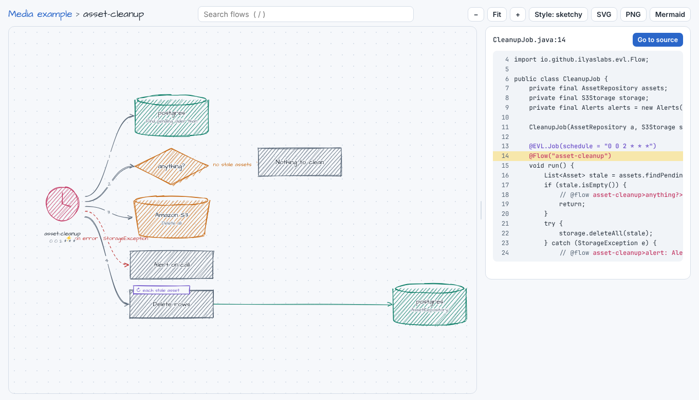

# 8. Using the map

## Opening it

- **Tools > EVL > Open EVL Map**, or `⌥⌘E` / `Ctrl+Alt+Shift+E`.
- The **EVL tool window** on the left lists every flow as a tree, with an icon for each kind (endpoint, job, decision, loop, error...). Double-click a node, or press Enter, to show it on the map. Type in its search box to filter.
- Click the **EVL gutter icon** next to any `@Flow` or `// @flow` line to jump to that path on the map.

## Reading the views

- **Root**: every flow, with callers and schedulers on the left and resources on the right.
- **A flow's level**: the flow and its steps, numbered in call order, with arrows to the resources each step uses.

## Mouse and keyboard

| Do this | To |
| --- | --- |
| Click a box | select it and show its code on the right |
| Click **+** on a box | draw its steps here, in the same view (it turns into **−** to fold them) |
| Click a selected box again | same as **+** |
| `⌘`/`Ctrl` + click **+** or a box | open it in a fresh view of its own |
| Double-click a box | go to its code |
| `⌘B` / `Ctrl+B` | go to the selected box's code |
| Breadcrumbs at the top | go back up; `Backspace` or `Esc` also goes up one level |
| Mouse wheel or two-finger swipe | pan |
| Drag the background, or drag with the middle button | pan |
| `⌘`/`Ctrl` + wheel, or pinch | zoom at the cursor |
| **−**, **Fit**, **+** | zoom out, fit everything, zoom in |

Drag the bar between the map and the code panel to resize the panel; EVL remembers the width.

## Search

Type in the search box (or press `/`). It matches path ids, labels, descriptions and endpoint paths, including the class-level prefix, so `/uploads`, `v1 media` or `thumbnail` all work. Pick a result to jump to it.

## Clean and sketchy

The map draws in a **clean** style by default. **Style: clean** switches to the hand-drawn **sketchy** style, handy for slides and design reviews:

## Export

The toolbar's **SVG**, **PNG** and **Mermaid** buttons save exactly what you see:

- **SVG**: a vector image with the font embedded, for docs and wikis.
- **PNG**: a 2× image for chats and slides.
- **Mermaid**: a `flowchart LR` you can paste into a README or pull request, where GitHub renders it.

In the IDE, a save dialog asks where to put the file.

## Problems

If a tag has a problem (a bad path, a path tagged twice, an `after` that points nowhere), a **Problems** card appears on the right with the file and line. Chapter 11 lists every message.

Next: [The CLI](09-cli.md)
