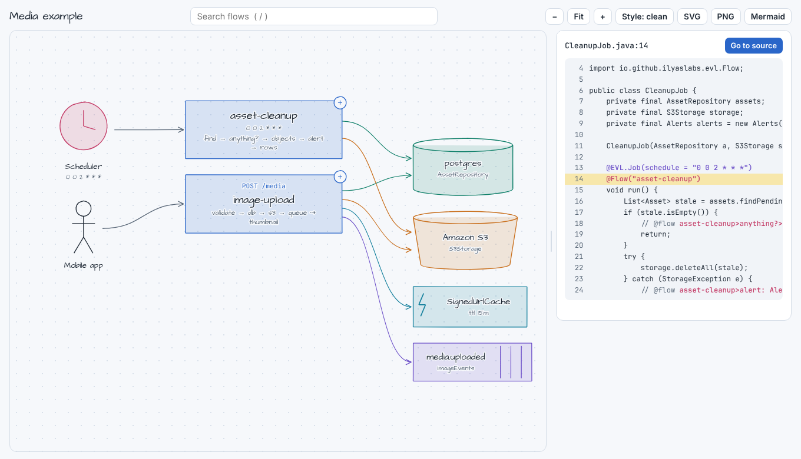

# The EVL developer guide

EVL turns tags in your Java or Kotlin code into a hand-drawn map of how your system works: which endpoint or job starts a flow, which steps run in which order, where it branches, loops or fails, and which databases, buckets, queues and services it touches.

This guide teaches EVL from the first tag to the advanced patterns. Read it in order the first time; every chapter builds on the one before and uses the same example, a small media service ([examples/media](https://github.com/ilyaslabs/evl-lib/tree/main/examples/media)).



> **The maps are drawn by the EVL IntelliJ plugin.** The annotations and the CLI work on their own, but to see the hand-drawn flow maps you need the [EVL plugin from JetBrains Marketplace](https://plugins.jetbrains.com/plugin/36145) (IntelliJ IDEA 2026.3 or newer; free for up to 10 flows).

<div id="evl-plugin-card-guide"></div>
<script src="https://plugins.jetbrains.com/assets/scripts/mp-widget.js"></script>
<script>
  MarketplaceWidget.setupMarketplaceWidget('card', 36145, "#evl-plugin-card-guide");
</script>

## Chapters

| # | Chapter | You will learn |
| --- | --- | --- |
| 1 | [Install](01-install.md) | Add the annotations, install the IntelliJ plugin, get the CLI |
| 2 | [Your first flow](02-first-flow.md) | Tag an endpoint and two steps, and open the map |
| 3 | [Paths in depth](03-paths.md) | How paths merge into a tree, ids, labels, order and inline markers |
| 4 | [Symbols and resources](04-symbols.md) | `@EVL.*` shapes, resources and the arrows EVL draws for you |
| 5 | [Async steps and jobs](05-async.md) | Queues, listeners, schedulers and `after` |
| 6 | [Branches, loops and errors](06-branches.md) | `?` decisions, `when`, `each`, `onError` |
| 7 | [Shared code and big systems](07-shared-code.md) | Code used by several flows, modules, naming at scale |
| 8 | [Using the map](08-map.md) | Navigation, expand in place, search, zoom, export, the tool window |
| 9 | [The CLI](09-cli.md) | Check tags in a terminal or in CI, JSON output |
| 10 | [Good maps](10-best-practices.md) | What to tag, what to leave out, a review checklist |
| 11 | [Reference](11-reference.md) | Every annotation, attribute, marker form and problem message |
| 12 | [Troubleshooting](12-troubleshooting.md) | When the map is not what you expected |

## The idea in one minute

```java
@EVL.Endpoint(method = "POST", path = "/media", caller = "Mobile app")
@Flow("image-upload")
public UploadResponse upload(UploadRequest request) {
    validator.check(request);        // check() carries @Flow("image-upload>validate")
    assets.savePending(request);     // savePending() carries @Flow("image-upload>db")
    // @flow image-upload>notify: Tell the user [when quota is almost used]
    ...
}
```

- `@Flow("a>b>c")` puts code on a **path**. All paths in your project merge into one tree.
- `@EVL.*` annotations only choose the **shape** (endpoint, database, queue...).
- EVL works out the **order** of steps and the **arrows** to resources from your code's calls.
- Nothing is inferred from frameworks, and there is no YAML: the code is the documentation.
